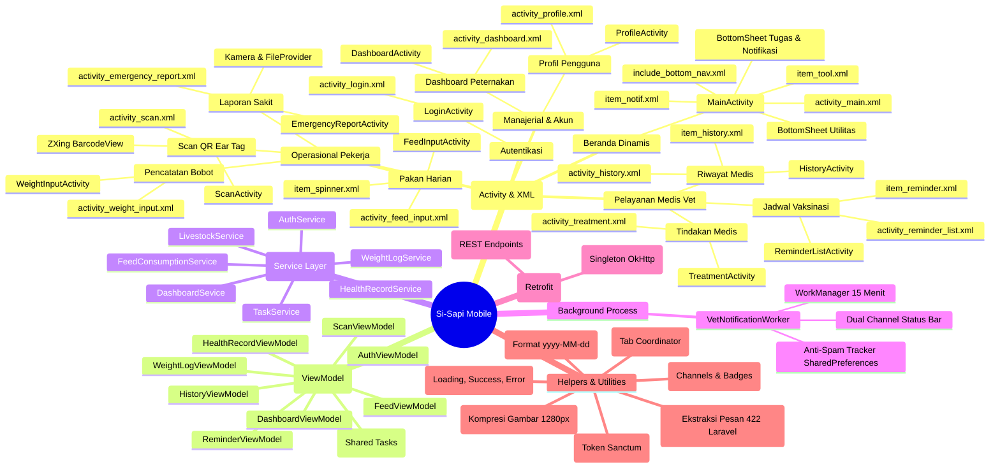

# 🗺️ Mind Map & Katalog Arsitektur SISapi Mobile (Kotlin)
> **Dokumen Referensi Teknis & Panduan Desain UI/UX (Handover untuk Argon)**  
> Tanggal: 26 Oktober 2026 | Versi: 5.0

---

## 1. Visual Mind Map (Mermaid Diagram)

---

## 2. Katalog Lengkap File & Fungsinya

### A. Lapisan Antarmuka Pengguna (UI & Layout)
File-file di bawah ini adalah fokus utama yang dapat dipoles tampilannya oleh **Argon**:

| File Kotlin | File Layout XML | Fungsi & Alur Layar | Elemen Kunci UI yang Perlu Diperhatikan |
|---|---|---|---|
| [`LoginActivity.kt`](file:///d:/last_ride/SISapiMobile/app/src/main/java/com/latihan/si_sapimobile/ui/LoginActivity.kt) | `activity_login.xml` | Gerbang masuk aplikasi. Auto-login jika token tersimpan. | Input email & password, tombol toggle *Show/Hide password*, pesan error inline merah, tombol loading. |
| [`MainActivity.kt`](file:///d:/last_ride/SISapiMobile/app/src/main/java/com/latihan/si_sapimobile/ui/MainActivity.kt) | `activity_main.xml` | Pusat kendali utama (*Home*). Memiliki 2 lapis panel: Utilitas dan Tugas/Notifikasi. | Header melengkung, badge role, bottom sheet yang bisa digeser, grid alat (2x2), list tugas/notifikasi. |
| [`ScanActivity.kt`](file:///d:/last_ride/SISapiMobile/app/src/main/java/com/latihan/si_sapimobile/ui/ScanActivity.kt) | `activity_scan.xml` | Pemindai QR Ear Tag sapi fisik + Kartu Profil Sapi instan. Memiliki 4 mode (`scan`, `weight`, `report`, `treatment`). | Viewfinder kamera ZXing, tombol nyalakan flash, kolom ketik tag manual, kartu ringkasan profil sapi. |
| [`WeightInputActivity.kt`](file:///d:/last_ride/SISapiMobile/app/src/main/java/com/latihan/si_sapimobile/ui/WeightInputActivity.kt) | `activity_weight_input.xml` | Input timbangan berkala bobot sapi. | Label bobot sebelumnya, input angka besar (32sp), kalkulator deviasi (+/- kg), dialog peringatan jika lonjakan >25%. |
| [`FeedInputActivity.kt`](file:///d:/last_ride/SISapiMobile/app/src/main/java/com/latihan/si_sapimobile/ui/FeedInputActivity.kt) | `activity_feed_input.xml` | Pencatatan pakan harian per kandang (metode FIFO). | Spinner dropdown pilih kandang, spinner jenis pakan, indikator sisa stok gudang, input jumlah (kg). |
| [`EmergencyReportActivity.kt`](file:///d:/last_ride/SISapiMobile/app/src/main/java/com/latihan/si_sapimobile/ui/EmergencyReportActivity.kt) | `activity_emergency_report.xml` | Pelaporan darurat sapi sakit oleh pekerja lapangan. | Preview foto kamera, tombol ambil/ganti foto, form teks gejala klinis, form tindakan pertama darurat. |
| [`ReminderListActivity.kt`](file:///d:/last_ride/SISapiMobile/app/src/main/java/com/latihan/si_sapimobile/ui/ReminderListActivity.kt) | `activity_reminder_list.xml` | Daftar antrean sapi yang butuh vaksinasi (khusus Vet). | List kartu vaksinasi, badge urgensi (Terlambat, Hari Ini, Akan Datang), tombol cepat tindakan. |
| [`TreatmentActivity.kt`](file:///d:/last_ride/SISapiMobile/app/src/main/java/com/latihan/si_sapimobile/ui/TreatmentActivity.kt) | `activity_treatment.xml` | Pencatatan medis resmi oleh Dokter Hewan (vaksin / obat). | Pilihan tipe (Vaksinasi / Pengobatan), kolom diagnosis, kolom resep/obat, date picker jadwal vaksin berikutnya. |
| [`HistoryActivity.kt`](file:///d:/last_ride/SISapiMobile/app/src/main/java/com/latihan/si_sapimobile/ui/HistoryActivity.kt) | `activity_history.xml` | Rekam medis riwayat kesehatan per individu sapi. | Timeline vertikal riwayat rekam medis, dokter pemeriksa, tanggal, dan badge diagnosis. |
| [`DashboardActivity.kt`](file:///d:/last_ride/SISapiMobile/app/src/main/java/com/latihan/si_sapimobile/ui/DashboardActivity.kt) | `activity_dashboard.xml` | Ringkasan analitik peternakan untuk Manager. | Kartu metrik (Total Sapi, Sapi Sakit, Siap Jual, Stok Pakan Kritis, ADG rata-rata). |
| [`ProfileActivity.kt`](file:///d:/last_ride/SISapiMobile/app/src/main/java/com/latihan/si_sapimobile/ui/ProfileActivity.kt) | `activity_profile.xml` | Informasi akun pengguna dan tombol Keluar. | Avatar pengguna, badge peran, rincian email, dialog konfirmasi Logout berwarna merah. |

---

### B. Komponen Layout Pendukung (Reused Layout Components)

* **`include_bottom_nav.xml`**: Navigasi bawah 3 tab (*Riwayat*, *Beranda*, *Profil*). Tab Beranda di tengah memiliki tombol lingkaran menonjol (*floating tab style*).
* **`item_tool.xml`**: Template kartu tombol alat di Beranda. Berisi kotak ikon, judul alat, dan deskripsi singkat dengan *stroke* berwarna.
* **`item_notif.xml`**: Template kartu tugas harian / notifikasi darurat. Memiliki garis aksen samping (*left accent bar*), judul, dan detail.
* **`item_reminder.xml`**: Kartu baris vaksinasi jatuh tempo dengan chip tanggal.
* **`item_history.xml`**: Baris item timeline rekam medis sapi.
* **`item_spinner.xml`**: Tampilan kustom dropdown spinner pakan dan kandang.

---

### C. Lapisan State Management (ViewModels)
Bertanggung jawab menjaga data tetap bertahan saat layar diputar (*orientation change*) dan mengontrol status `UiState`:

1. **`AuthViewModel.kt`**: Mengatur proses login, validasi email/password kosong, dan trigger logout.
2. **`TaskViewModel.kt`**: Mengatur state `WorkerTaskResponse` untuk tugas harian pekerja di Beranda.
3. **`ScanViewModel.kt`**: Mengambil data profil sapi berdasarkan nomor tag dari barcode scanner.
4. **`WeightLogViewModel.kt`**: Memvalidasi angka timbangan dan mengirim data timbangan baru.
5. **`FeedViewModel.kt`**: Mengambil daftar kandang + stok pakan, dan memvalidasi input pakan.
6. **`HealthRecordViewModel.kt`**: Memproses kompresi foto kamera dan pengiriman laporan darurat multipart.
7. **`ReminderViewModel.kt`**: Memuat data vaksin jatuh tempo (`due`) dan laporan darurat (`emergency`).
8. **`HistoryViewModel.kt`**: Mengambil daftar riwayat rekam medis sapi tertentu.
9. **`DashboardViewModel.kt`**: Mengambil angka ringkasan peternakan untuk dashboard manager.

---

### D. Lapisan Bisnis & Jaringan (Services & Network)

* **`network/ApiClient.kt`**: Singleton konfigurasi Retrofit 2 + OkHttp Client. Otomatis menyematkan `Accept: application/json`, menyisipkan token Bearer dari `SessionManager`, dan mengaktifkan timeout 30 detik.
* **`network/ApiService.kt`**: Kumpulan interface endpoint REST API Laravel (`/login`, `/logout`, `/livestocks/{tag}`, `/cages/{id}/feed`, `/worker/daily-tasks`, dll.).
* **`services/TaskService.kt`**: Menghubungkan ViewModel dengan endpoint tugas harian.
* **`services/AuthService.kt`**: Menyimpan token ke sesi saat login sukses, dan membatalkan worker saat logout.
* **`services/LivestockService.kt`**: Mengambil profil sapi lengkap berdasarkan tag.
* **`services/WeightLogService.kt`**: Menyimpan catatan timbang bobot.
* **`services/FeedConsumptionService.kt`**: Mengambil master data pakan dan mencatat pemakaian.
* **`services/HealthRecordService.kt`**: Mengunggah laporan darurat berfoto dan menyimpan tindakan medis.

---

### E. Background Worker & Helpers

* **`workers/VetNotificationWorker.kt`**: Android `CoroutineWorker` yang dijadwalkan via `WorkManager` setiap 15 menit. Berjalan otomatis di latar belakang untuk memeriksa laporan darurat sapi sakit & vaksin jatuh tempo khusus untuk Dokter Hewan.
* **`helpers/NotificationHelper.kt`**: Pusat pemicu notifikasi status bar Android dengan 2 channel terpisah (`sisapi_emergency_channel` & `sisapi_vaccine_channel`).
* **`helpers/SessionManager.kt`**: Enkapsulasi `SharedPreferences` untuk menyimpan token Sanctum, nama, email, dan role pengguna.
* **`helpers/ImageHelper.kt`**: Fungsi utilitas kompresi foto kamera (maksimal resolusi 1280px, format JPEG 80%, rotasi sesuai metadata EXIF) agar tidak melebihi batas 5MB server.
* **`helpers/ErrorParser.kt`**: Membaca format error JSON dari Laravel (HTTP 422 validasi maupun pesan umum HTTP 400/500).
* **`helpers/UiState.kt`**: Sealed class generic untuk penanganan 3 kondisi UI: `UiState.Loading`, `UiState.Success<T>`, dan `UiState.Error`.

---

## 3. Panduan Token Desain & Palet Warna (Untuk Argon)

Gunakan token warna resmi berikut yang sudah terdaftar di `res/values/colors_sisapi.xml` dan `colors_home.xml`:

| Nama Token | Kode HEX | Filosofi & Rekomendasi Pemakaian UI |
|---|---|---|
| **`navy`** | `#1B1464` | Warna teks judul utama, teks header beranda, teks tebal. |
| **`royal`** | `#2D5FAD` | Warna tombol aksi utama (*Primary Button*), border kartu aktif. |
| **`sky`** | `#1890DB` | Warna latar header melengkung, ikon aktif, tombol tengah Beranda. |
| **`mist`** | `#EEF4FD` | Latar belakang seluruh layar (*Screen Background*), memberi kesan bersih & modern. |
| **`ink`** | `#10183A` | Warna teks isi (*body text*), nilai input form. |
| **`muted`** | `#566384` | Warna teks petunjuk (*placeholder*), label pendukung, tanggal. |
| **`line`** | `#8FA3CC` | Warna garis batas (*border*) kolom input dan pemisah tabel. |
| **`ok`** | `#17784F` | Warna status berhasil, tugas selesai (`✓`), sapi sehat, stok aman. |
| **`danger`** | `#C62828` | Warna status bahaya/darurat (`🚨`), tombol keluar, sapi sakit parah. |
| **`notif_warn`** | `#E08A00` | Warna status peringatan/pending (`⏱`), tugas belum selesai, vaksin mendekati jadwal. |
| **`tile_royal`** | `#E3ECFB` | Latar belakang lembut kartu alat Scan QR. |
| **`tile_sky`** | `#DDF1FD` | Latar belakang lembut kartu alat Timbangan. |
| **`tile_ok`** | `#E1F5EC` | Latar belakang lembut kartu alat Pakan. |
| **`tile_amber`** | `#FFF1D6` | Latar belakang lembut kartu alat Rekam Medis. |
| **`tile_danger`** | `#FDE9E9` | Latar belakang lembut kartu alat Lapor Sakit. |

### Aturan Tipografi & Spasi UI Lapangan:
* **Ukuran Teks Utama:** Minimal **16sp** agar mudah dibaca di luar ruangan/kandang yang silau.
* **Target Ketuk (Touch Target):** Tombol dan kartu minimal setinggi **48dp** agar mudah ditekan pekerja dengan jari atau sarung tangan.
* **Corner Radius:** Sudut kartu dan tombol standar **12dp s.d. 24dp** untuk nuansa modern dan ramah pengguna.
