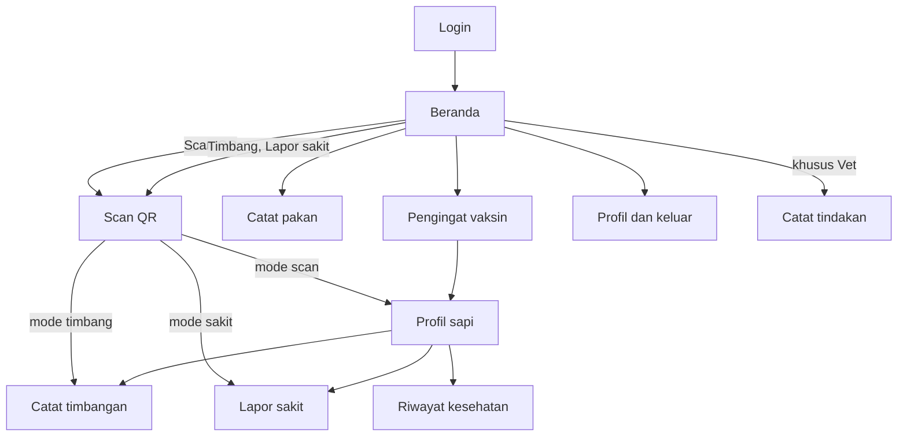

# Si-Sapi Mobile

Rancangan UI/UX untuk aplikasi Kotlin: 19 mockup layar, peta layar ke Activity dan endpoint, serta daftar perubahan dari desain awalmu.

[Masuk dan beranda](#alur-masuk)[Scan dan profil sapi](#alur-scan)[Input harian](#alur-input)[Dokter hewan dan pengingat](#alur-vet)[Kondisi khusus](#state)[Dasar visual](#dasar)[Peta ke kode](#peta)[Perubahan](#ubah)

## Masuk dan beranda

Login dan Beranda adalah dua desain awalmu yang sudah dirapikan. Beranda Pekerja dan Dokter hewan memakai kerangka sama, hanya isi tile Alat yang berbeda.

08.00

# Masuk

Masuk untuk memakai aplikasi Si-Sapi

Email anggota

budi@peternakan.com

Password

Masukkan password

Masuk

**Login**`LoginActivity`

08.00

# Masuk

Masuk untuk memakai aplikasi Si-Sapi

Email anggota

budi@peternakan.com

Password

••••••••

Email atau password salah. Periksa lagi, lalu coba masuk.

Masuk

**Login, password salah**`LoginActivity`

08.00

Halo, Budi

Pekerja

Kamis, 1 Okt 2026

Alat

**Scan QR**Lihat profil sapi

**Timbang**Catat berat badan

**Pakan**Catat pakan harian

**Lapor sakit**Laporan darurat

PengingatLihat semua

**SPI-0017 · Vaksin PMK**Jatuh tempo 2 hari lagi

**SPI-0031 · Vaksin Antraks**Terlambat 2 hari

Riwayat

Beranda

Profil

**Beranda Pekerja**`MainActivity + HomeFragment`

08.00

Halo, drh. Sari

Dokter hewan

Kamis, 1 Okt 2026

Alat

**Scan QR**Lihat profil sapi

**Vaksin**Jatuh tempo

**Tindakan**Catat vaksin / obat

**Rekam medis**Riwayat sapi

PengingatLihat semua

**SPI-0017 · Vaksin PMK**Jatuh tempo 2 hari lagi

**SPI-0031 · Vaksin Antraks**Terlambat 2 hari

Riwayat

Beranda

Profil

**Beranda Dokter hewan**`MainActivity + HomeFragment`

## Scan dan profil sapi

Scan QR dipakai tiga tombol: Scan QR (buka profil), Timbang (langsung ke form), dan Lapor sakit (langsung ke form). Mode dikirim lewat Intent extra, jadi hanya ada satu ScanActivity.

08.00

Timbang sapi

Arahkan kamera ke QR di ear tag

Ketik nomor tag

**Scan QR**`ScanActivity`

08.00

Timbang sapi

Arahkan kamera ke QR di ear tag

Ketik nomor tag

### Ketik nomor tag

Pakai ini kalau ear tag kotor atau QR tidak terbaca.

Nomor tag

SPI-00

Cari sapi

**Ketik nomor tag**`ScanActivity (bottom sheet)`

08.00

Profil sapi

SPI-0042

SimentalJantan

Kandang**Kandang A**

Umur**14 bulan**

Berat terakhir**342 kg *28 Sep***

Vaksin berikutnya**PMK 4 hari lagi**

Catat timbangan

Lapor sakit

Lihat riwayat kesehatan

**Profil sapi**`LivestockDetailActivity`

## Input harian

Tiga form utama pekerja kandang. Setiap form menampilkan sapi atau kandang yang dipilih di bagian atas, dan satu tombol utama di bawah.

08.00

Catat timbangan

**SPI-0042**Simental · Jantan · Kandang A

Berat badan

358,5kg

Naik 16,5 kg dari timbangan terakhir (342 kg, 28 Sep)

Tanggal timbang

Hari ini, 1 Okt 2026

Simpan timbangan

**Catat timbangan**`WeightInputActivity`

08.00

## Timbangan tersimpan

SPI-0042 · 358,5 kg · 1 Okt 2026

Naik 16,5 kg dari 28 Sep

Timbang sapi lain

Kembali ke beranda

**Timbangan tersimpan**`WeightInputActivity (UiState.Success)`

08.00

Catat pemakaian pakan

Kandang

Kandang A · 12 sapi

Jenis pakan

Konsentrat · stok 420 kg

Jumlah dipakai

35kg

Sisa stok setelah ini: 385 kg

Pakan diambil dari batch masuk paling lama (FIFO). Kamu tidak perlu memilih batch.

Simpan pemakaian

**Catat pemakaian pakan**`FeedInputActivity`

08.00

Lapor sakit

Laporan darurat

**SPI-0042**Simental · Jantan · Kandang A

Foto kondisi sapi

**Ambil foto**Foto yang jelas membantu dokter hewan

Gejala yang terlihat

Pincang di kaki kanan belakang, nafsu makan turun sejak pagi.

Tindakan awal (boleh kosong)

Sapi dipisah ke kandang isolasi

Kirim laporan darurat

**Lapor sakit**`EmergencyReportActivity`

## Dokter hewan dan pengingat

Endpoint health-records/due sudah ada di backend, jadi pengingat vaksin bisa jalan tanpa mengubah API.

08.00

Pengingat vaksin

Jatuh tempo dalam 7 hari

**SPI-0031 · Antraks**Jatuh tempo 29 SepTerlambat 2 hari

**SPI-0017 · PMK**Jatuh tempo 3 Okt2 hari lagi

**SPI-0042 · PMK**Jatuh tempo 5 Okt4 hari lagi

**SPI-0008 · PMK**Jatuh tempo 7 Okt6 hari lagi

Ketuk satu baris untuk membuka profil sapi.

**Pengingat vaksin**`ReminderListActivity`

08.00

Catat tindakan

Dokter hewan

**SPI-0042**Simental · Jantan · Kandang A

Vaksinasi

Pengobatan

Diagnosis / jenis vaksin

Vaksin PMK dosis 2

Tindakan / catatan

Suntik 2 ml, subkutan

Jadwal berikutnya

5 Nov 2026

Muncul sebagai pengingat 7 hari sebelumnya.

Simpan tindakan

**Catat tindakan**`TreatmentActivity`

08.00

Riwayat kesehatan

SPI-0042

Darurat30 Sep

**Pincang kaki kanan belakang**Ditangani drh. Sari

Vaksinasi12 Sep

**Vaksin PMK dosis 1**Berikutnya 5 Okt

Pengobatan20 Agu

**Cacingan ringan**Obat cacing oral

Riwayat

Beranda

Profil

**Riwayat kesehatan**`HistoryFragment`

08.00

Profil

BS

**Budi Santoso**budi@peternakan.comPekerja

Telepon**0812 3456 7890**

Versi aplikasi**1.0**

Keluar

Riwayat

Beranda

Profil

### Keluar dari Si-Sapi?

Kamu perlu masuk lagi untuk memakai aplikasi.

Batal

Keluar

**Profil + konfirmasi keluar**`ProfileFragment`

## Kondisi khusus

Layar yang sering terlupa tapi muncul saat demo: data belum datang, server mati, tag salah, dan daftar kosong.

08.00

Profil sapi

**Memuat data**`UiState.Loading`

08.00

Profil sapi

## Tidak terhubung ke server

Cek koneksi internet, lalu coba lagi.

Coba lagi

**Server tidak terjangkau**`UiState.Error`

08.00

Profil sapi

## Sapi tidak ditemukan

Tag SPI-9999 belum terdaftar. Periksa nomornya atau scan ulang.

Scan ulang

Ketik nomor tag

**Tag tidak ditemukan**`UiState.Error (404)`

08.00

Pengingat vaksin

## Tidak ada vaksin jatuh tempo

Pengingat muncul 7 hari sebelum jadwal vaksin sapi.

**Daftar kosong**`Empty state`

## Dasar visual

Warna dan bentuk tetap dari desainmu (biru Si-Sapi, kartu membulat, header melengkung). Yang berubah: ukuran teks dan kontras.

**Navy**`#1B1464`Judul

**Royal**`#2D5FAD`Tombol utama

**Sky**`#1890DB`Header, tombol Beranda

**Mist**`#EEF4FD`Latar layar

**Ink**`#10183A`Teks isi

**Muted**`#566384`Teks pendukung

**Danger**`#C62828`Sakit, terlambat, keluar

**Warn**`#B45309`Segera jatuh tempo

**Ok**`#17784F`Berhasil, naik berat

| Elemen | Ukuran | Alasan |
| --- | --- | --- |
| Judul layar | 24sp, Lexend 700 | Terbaca sekilas di luar ruangan |
| Angka berat dan jumlah pakan | 40sp | Input utama, harus paling menonjol |
| Teks isi dan tombol | 16sp | Sebelumnya terlalu kecil di desainmu |
| Teks pendukung | 14sp (batas bawah) | Tidak ada teks di bawah 14sp |
| Area ketuk | minimal 48dp | Dipakai sambil memakai sarung tangan atau tangan kotor |
| Sudut | Tombol dan kolom 12dp, kartu 16dp, sheet 24dp | Konsisten dengan desainmu |
| Margin layar | 16dp, jarak antar elemen 12dp | Satu ritme di semua layar |

Mockup digambar dengan skala 0,83 dari layar 360dp, jadi angka sp di tabel setara sekitar 83% ukuran pikselnya di halaman ini. Font Lexend dimasukkan ke `res/font`. Kalau font desainmu bukan Lexend, ganti saja di `themes.xml`.

```
<!-- res/values/colors.xml -->
<color name="navy">#1B1464</color>
<color name="royal">#2D5FAD</color>
<color name="sky">#1890DB</color>
<color name="mist">#EEF4FD</color>
<color name="ink">#10183A</color>
<color name="muted">#566384</color>
<color name="line">#CBD6EA</color>
<color name="danger">#C62828</color>
<color name="warn">#B45309</color>
<color name="ok">#17784F</color>
```

## Peta layar ke kode

Ini menggantikan tabel Referensi API di Checkpoint Mobile v2. Activity bertambah dari 6 menjadi 9, ditambah 3 Fragment untuk tab bottom nav, karena ada Pengingat, Profil sapi, dan Catat tindakan.



| Layar | Class | ViewModel | Endpoint | Role | Catatan |
| --- | --- | --- | --- | --- | --- |
| **Login** | `LoginActivity` | AuthViewModel | `POST /login` | Semua | Simpan token + role di SessionManager. Error 401 tampil inline di bawah password. |
| **Beranda (Pekerja / Vet)** | `MainActivity + HomeFragment` | AuthViewModel, HealthRecordViewModel | `GET /me, GET /health-records/due` | Semua | Tile Alat ditentukan oleh role. Pengingat = 2 item terdekat dari endpoint due. |
| **Pengingat vaksin** | `ReminderListActivity` | HealthRecordViewModel | `GET /health-records/due` | Semua | Sudah terurut dari jatuh tempo terdekat. Ketuk baris membuka profil sapi. |
| **Scan QR** | `ScanActivity` | - (hasil scan dikirim ke layar tujuan) | `-` | Semua | Satu layar, tiga mode lewat Intent extra: scan, timbang, sakit. Ada tombol ketik nomor tag. |
| **Profil sapi** | `LivestockDetailActivity` | LivestockViewModel | `GET /livestocks/{tagNumber}` | Semua | Tag tidak ada: tampil state "Sapi tidak ditemukan". |
| **Catat timbangan** | `WeightInputActivity` | WeightLogViewModel | `POST /livestocks/{tagNumber}/weight-logs` | Pekerja | Kirim berat + tanggal. Cek nama field persis di WeightLogController. Selisih dari berat terakhir dihitung di sisi app. |
| **Timbangan tersimpan** | `(state di WeightInputActivity)` | WeightLogViewModel | `-` | Pekerja | Tampilkan lewat UiState.Success, bukan Activity baru. |
| **Catat pakan** | `FeedInputActivity` | FeedViewModel | `GET /cages, GET /feeds, POST /cages/{id}/feed` | Pekerja | Field amount_used (min 0,01). Stok dari GET /feeds untuk preview sisa. |
| **Lapor sakit** | `EmergencyReportActivity` | HealthRecordViewModel | `POST /livestocks/{tagNumber}/health-report` | Pekerja, Vet | Multipart: type=emergency_report, date, diagnosis (gejala), treatment, photo. |
| **Catat tindakan** | `TreatmentActivity` | HealthRecordViewModel | `POST /livestocks/{tagNumber}/health-report` | Vet | type=vaccination atau treatment. next_due_date hanya untuk vaksinasi. |
| **Riwayat kesehatan** | `HistoryFragment (di MainActivity)` | HealthRecordViewModel | `GET /livestocks/{tagNumber}/health-records` | Semua | Cari lewat tag atau scan. Sudah terurut terbaru. |
| **Profil + keluar** | `ProfileFragment (di MainActivity)` | AuthViewModel | `GET /me, POST /logout` | Semua | Dialog konfirmasi sebelum logout. Hapus token di SessionManager. |
| **State: loading / offline / tidak ditemukan / kosong** | `Komponen layout dipakai ulang` | UiState di semua ViewModel | `-` | Semua | Satu layout include untuk tiap state, supaya tidak ditulis ulang per Activity. |

Foto di Lapor sakit dikirim sebagai multipart di Retrofit (`@Multipart` dengan `MultipartBody.Part`). Itu bagian paling baru bagimu, jadi kerjakan paling akhir, sesuai urutan 10 langkah di checkpoint.

## Perubahan dari desainmu

### Teks lebih besar

Teks notifikasi dan deskripsi Alat naik ke minimal 14sp. Tombol Login 16sp. Aplikasi ini dipakai di kandang, sering kena matahari.

### Notifikasi menjadi Pengingat

Backend belum punya endpoint notifikasi dari manager, tapi `GET /health-records/due` sudah ada. Pengingat vaksin bisa jalan hari ini tanpa mengubah API. Kalau kamu tetap ingin pengumuman dari manager, perlu tabel dan endpoint baru, dan itu sebaiknya masuk daftar "pengembangan lanjutan" di laporan.

### Satu layar scroll, bukan dua panel yang saling membuka

Alat dipindah ke atas karena itu aksi utama. Pengingat di bawah, cukup 2 item plus "Lihat semua". Tampilannya hampir sama, tapi tidak butuh BottomSheet atau MotionLayout.

### Logout pindah ke Profil

Sebelumnya sejajar dengan Beranda dan Riwayat, jadi mudah tertekan tanpa sengaja. Sekarang ada dialog konfirmasi.

### Bottom nav punya label

Tombol Beranda yang menonjol di tengah tetap dipertahankan sebagai ciri desainmu. Di Android, buat dengan `LinearLayout` biasa, lalu geser lingkaran Beranda ke atas dengan `translationY` negatif dan beri elevation.

### Kolom login lebih jelas

Border kolom diperkuat, ada tombol lihat password, dan pesan error muncul langsung di kartu.

### "Worker" menjadi "Pekerja"

Bahasa konsisten dengan laporan dan aplikasi desktop.

### Timbang dan Lapor sakit langsung minta scan

Pekerja tidak perlu memilih sapi lewat dropdown. Ketik nomor tag disediakan sebagai cadangan kalau QR rusak.

### Keterbatasan backend yang perlu kamu putuskan

- **Notifikasi dari manager:** tidak ada endpoint. Solusi cepat: pakai pengingat vaksin seperti di atas.
- **Riwayat input milik pekerja:** tidak ada endpoint. Tab Riwayat saya ubah menjadi riwayat kesehatan per sapi (`GET /livestocks/{tag}/health-records`). Berat tidak punya endpoint riwayat, jadi profil sapi hanya menampilkan berat terakhir.
- **Nama field timbangan:** saya belum menemukan nama field pastinya di percakapan. Cek `WeightLogController` sebelum membuat `CreateWeightLogRequest`.
- **Logo:** yang tergambar di mockup hanya pengganti sederhana. Pakai logo aslimu saat membuat layout.

Rancangan ini belum diuji di perangkat. Ukuran piksel di halaman ini lebih kecil dari ukuran sebenarnya (skala 0,83).