# 📊 Pedoman & Spesifikasi Activity Diagram Si-Sapi
> **Dokumen Resmi Acuan Bab III Laporan Tugas Akhir / Ujikom**  
> **Proyek:** Si-Sapi (Smart Livestock Management System)  
> **Arsitektur:** Client-Server dengan pembagian alur proses spesifik untuk Desktop (WPF) dan Mobile (Android).

---

## 1. Ikhtisar Alur Aktivitas Berdasarkan Platform

Aplikasi Desktop berorientasi pada **manajemen data administratif, pencetakan QR, dan evaluasi analitik**, sedangkan aplikasi Mobile berorientasi pada **kecepatan operasional di lapangan, pemindaian sensor kamera (QR & foto), dan pencatatan riil**.

---

## 2. Activity Diagram: Platform Desktop (WPF)

### A. Alur 1: Pendaftaran Sapi Baru & Auto-Generate Nomor Tag (`SP-xxx`)
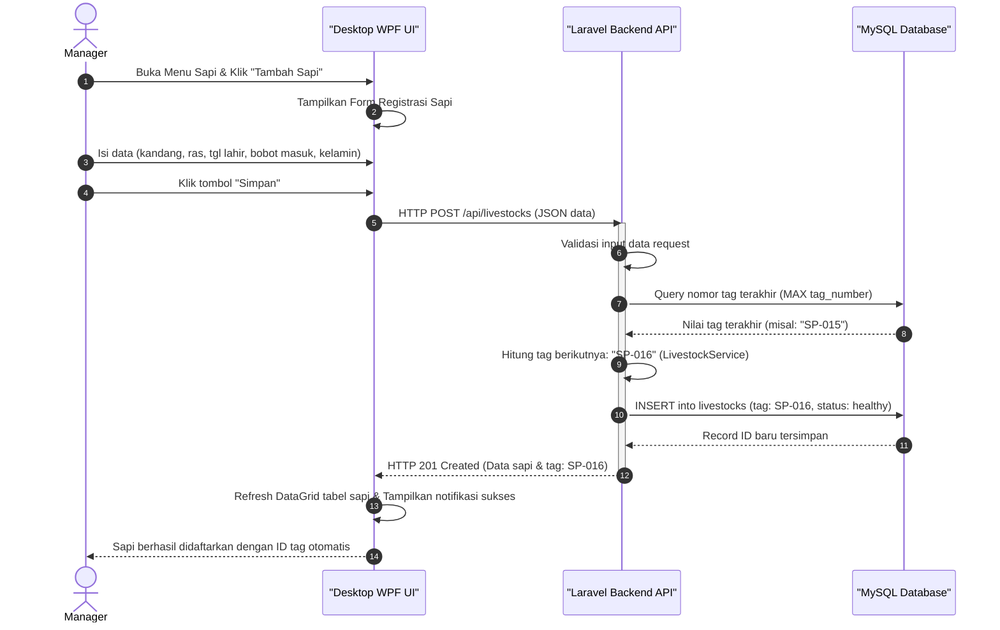

---

### B. Alur 2: Pencetakan Label QR Code Ear Tag
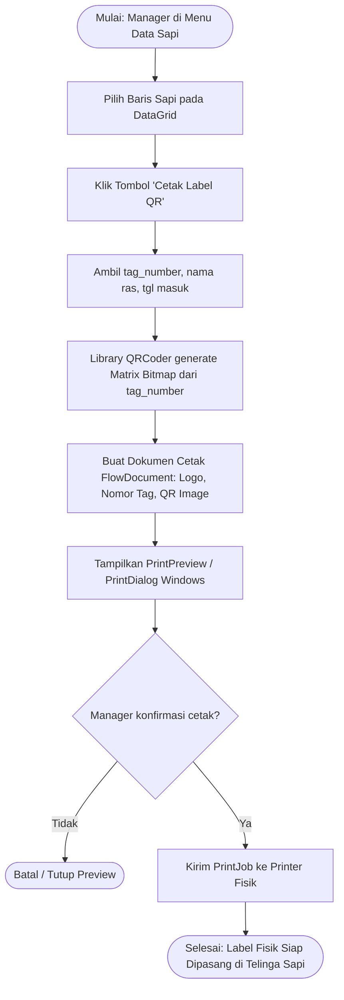

---

### C. Alur 3: Evaluasi & Pemantauan Laporan FCR Kandang
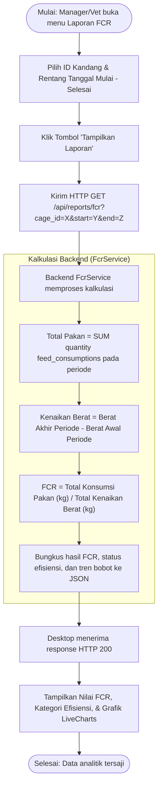

---

### D. Alur 4: Monitoring Rekam Medis & Peninjauan Foto Bukti Darurat
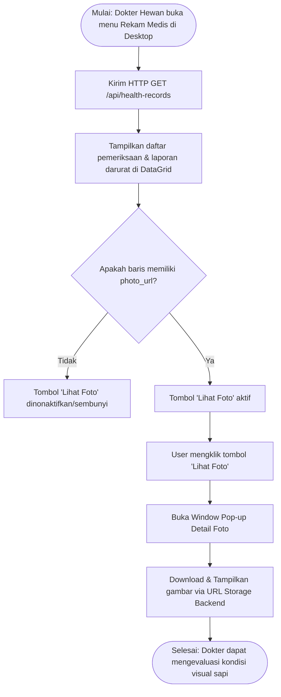

---

### E. Alur 5: Login & Autentikasi Pengguna Desktop
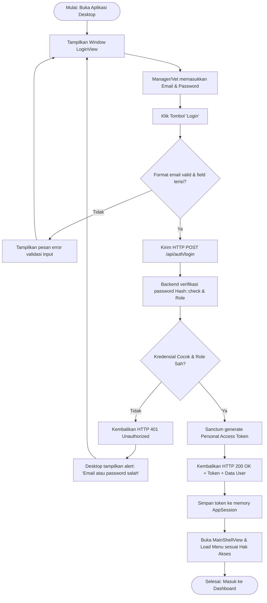

---

### F. Alur 6: Pengelolaan Data Master Kandang (CRUD)
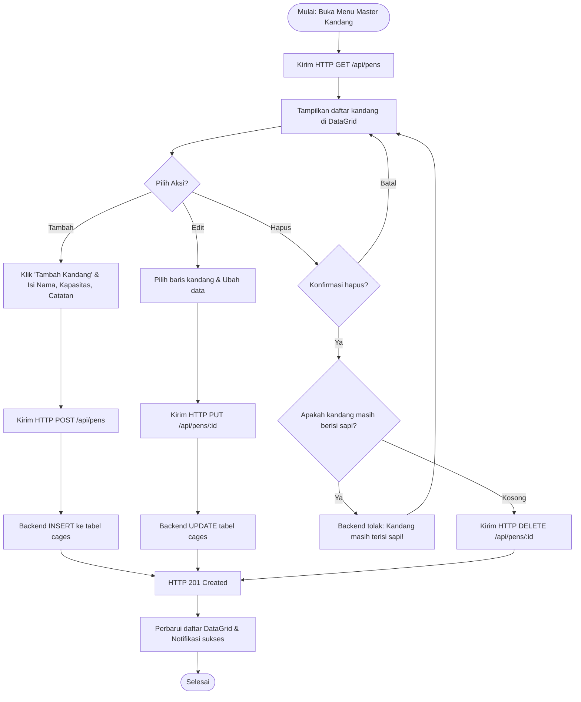

---

### G. Alur 7: Pengelolaan Data Master Pakan & Penerimaan Batch (FIFO)
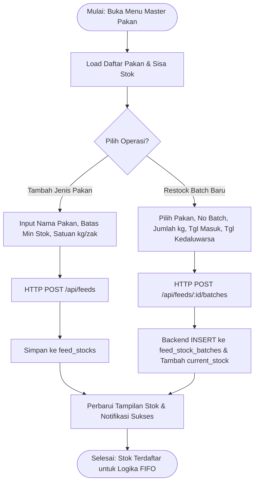

---

### H. Alur 8: Melihat Dashboard & Monitoring Ringkasan KPI
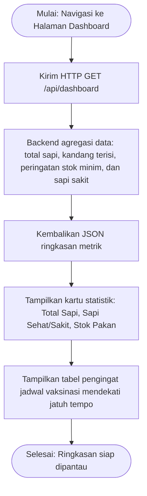

---

## 3. Activity Diagram: Platform Mobile (Android)


### A. Alur 5: Scan QR Code Ear Tag & Buka Profil Sapi
```mermaid
flowchart TD
    Start([Mulai: Worker/Vet buka aplikasi Mobile]) --> TapScan[Tekan Tombol 'Scan QR' di Bottom Navigation]
    TapScan --> CheckPerm{Izin Kamera diberikan?}
    CheckPerm -- Belum --> RequestPerm[Tampilkan dialog izin CAMERA]
    RequestPerm --> PermGranted{Disetujui?}
    PermGranted -- Tidak --> DenyMsg[Tampilkan pesan peringatan izin ditolak] --> TapScan
    PermGranted -- Ya --> OpenCam[Aktifkan Kamera ZXing Scanner View]
    CheckPerm -- Sudah --> OpenCam
    
    OpenCam --> PointToTag[Arahkan lensa kamera ke QR Code Ear Tag fisik sapi]
    PointToTag --> DetectQR[ZXing mendeteksi & decode payload string: 'SP-xxx']
    DetectQR --> TriggerBeep[Bunyikan beep getar & jeda kamera]
    TriggerBeep --> FetchProfile[Kirim HTTP GET /api/livestocks/tag/{tag_number}]
    
    FetchProfile --> APIResponse{Sapi ditemukan di database?}
    APIResponse -- Tidak --> Show404[Tampilkan toast 'Data Sapi Tidak Ditemukan'] --> OpenCam
    APIResponse -- Ya --> ShowProfile[Pindah ke Activity Detail Profil Sapi: ras, umur, bobot terakhir, kandang]
    ShowProfile --> Finish([Selesai: Profil siap untuk aksi lanjutan timbang / lapor])
```

---

### B. Alur 6: Input Penimbangan Cepat (Quick Weight Logging)
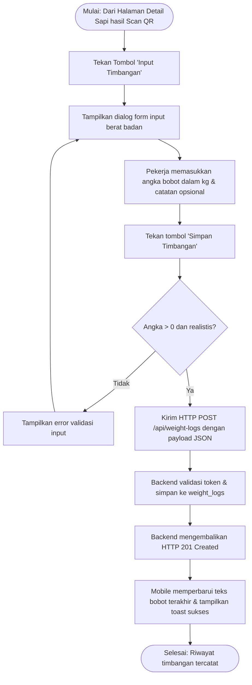

---

### C. Alur 7: Input Konsumsi Pakan Harian Kandang (Auto FIFO Deduction)
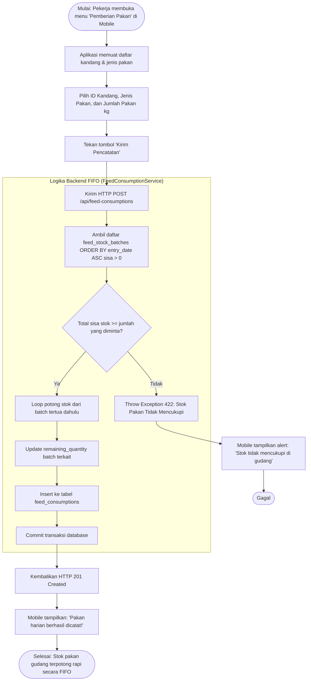

---

### D. Alur 8: Pelaporan Darurat Sapi Sakit dengan Foto Kamera (Multipart Upload)
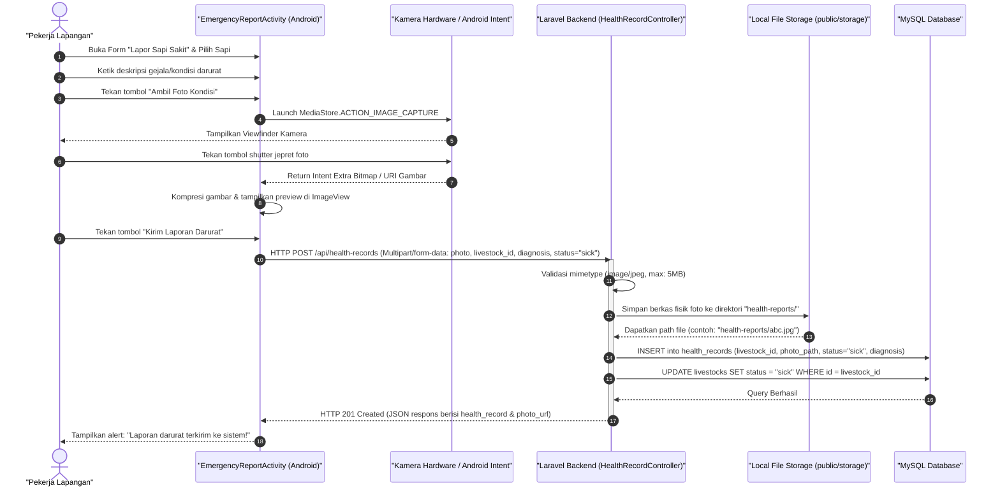

---

### E. Alur 13: Input Tindakan Medis Lapangan oleh Dokter Hewan (TreatmentActivity)
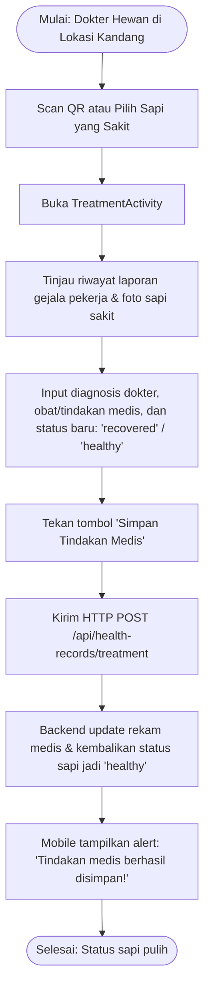

---

### F. Alur 14: Cek Pengingat / Reminder Jadwal Vaksinasi di Mobile
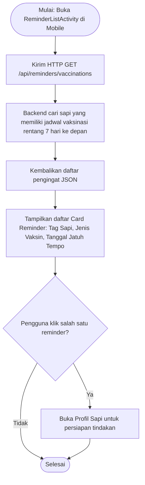

---

## 4. Panduan Prompt untuk AI Pembuat Diagram (PlantUML / Draw.io)


### Prompt Activity Diagram PlantUML:
```text
Buatkan Activity Diagram PlantUML modern dengan swimlane partisi (User, Mobile App, Laravel Backend, MySQL Database) untuk alur:
"Pelaporan Darurat Sapi Sakit Lengkap dengan Pengambilan Foto Kamera pada Aplikasi Si-Sapi".

Langkah yang harus ada:
1. User mengisi gejala di Mobile Form.
2. User membuka kamera dan mengambil foto fisik sapi.
3. Mobile memvalidasi dan mengompres foto.
4. Mobile mengirim HTTP POST multipart form data ke /api/health-records.
5. Backend Laravel memvalidasi file gambar dan menyimpannya di file storage.
6. Backend menyimpan record ke tabel health_records dan mengupdate status sapi menjadi 'sick'.
7. Backend mengembalikan status HTTP 201 Created.
8. Mobile menampilkan pesan sukses.
Gunakan styling yang estetik, warna pastel, dan panah vertikal yang rapi.
```
