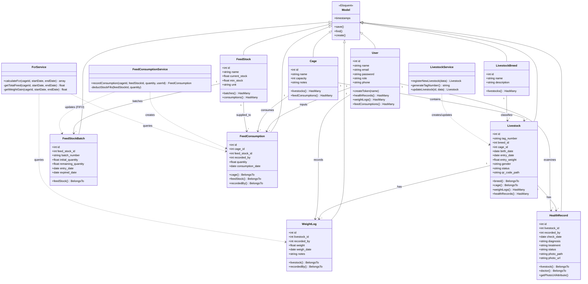
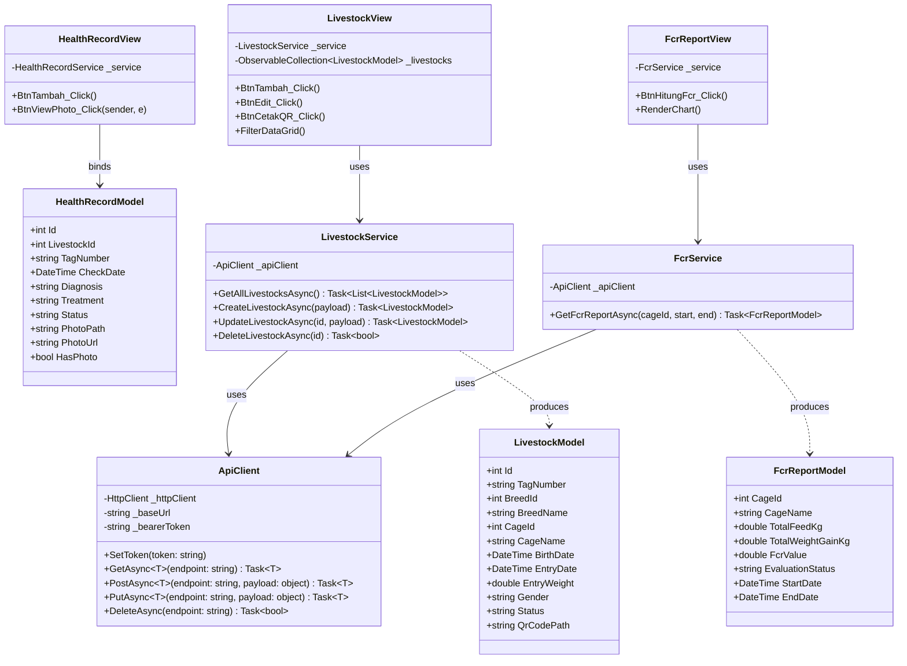
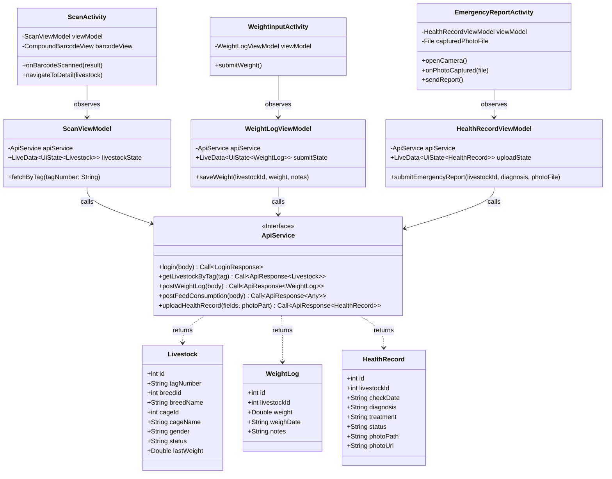

# 🏛️ Pedoman & Spesifikasi Class Diagram Si-Sapi
> **Dokumen Resmi Acuan Bab III Laporan Tugas Akhir / Ujikom**  
> **Proyek:** Si-Sapi (Smart Livestock Management System)  
> **Arsitektur:** Client-Server Multi-tier (Backend Laravel Eloquent & Service Layer, Client Desktop C# WPF MVVM/Code-behind, Client Mobile Kotlin Android MVVM).

---

## 1. Ikhtisar Arsitektur Kelas

Diagram kelas (*Class Diagram*) menggambarkan struktur statis sistem dengan memodelkan kelas-kelas, atribut, metode, serta hubungan ketergantungan dan pewarisan (*inheritance/association*).

Sistem Si-Sapi memiliki pembagian layer berorientasi objek yang rapi:
1. **Backend Laravel (PHP):** Model Eloquent ORM (mewarisi `Illuminate\Database\Eloquent\Model`), Service Layer untuk enkapsulasi logika bisnis, dan API Controllers untuk penanganan HTTP.
2. **Client Desktop (C# .NET WPF):** Model data DTO C# (dengan deserialisasi `Newtonsoft.Json`), Service Client (`HttpClient`), serta Window/Page View.
3. **Client Mobile (Kotlin Android Native):** Data Class (`@SerializedName`), Network Service (Retrofit2 Interface), Android Jetpack `ViewModel`, dan `AppCompatActivity`.

---

## 2. Class Diagram: Backend API (Laravel 11)

### Diagram Mermaid (Backend Models & Services)


---

## 3. Class Diagram: Client Desktop (C# .NET WPF)

### Diagram Mermaid (Desktop Architecture)


---

## 4. Class Diagram: Client Mobile (Kotlin Android Native)

### Diagram Mermaid (Mobile Architecture)


---

## 5. Panduan Prompt untuk AI Pembuat Diagram (PlantUML / Draw.io)

### Prompt Class Diagram PlantUML:
```text
Buatkan Class Diagram UML standar berorientasi objek menggunakan PlantUML untuk arsitektur Backend Laravel 11 pada sistem "Si-Sapi (Sistem Informasi Peternakan Sapi Potong)".

Model Utama yang harus dimodelkan (semua mewarisi Model):
- User (id, name, email, role, phone)
- Cage (id, name, capacity, notes)
- LivestockBreed (id, name, description)
- Livestock (id, tag_number, breed_id, cage_id, birth_date, entry_date, entry_weight, gender, status, qr_code_path)
- WeightLog (id, livestock_id, recorded_by, weight, weigh_date, notes)
- HealthRecord (id, livestock_id, recorded_by, check_date, diagnosis, treatment, status, photo_path, photo_url)
- FeedStock (id, name, current_stock, min_stock, unit)
- FeedStockBatch (id, feed_stock_id, batch_number, initial_quantity, remaining_quantity, entry_date, expired_date)
- FeedConsumption (id, cage_id, feed_stock_id, recorded_by, quantity, consumption_date)

Service Layer (Business Logic):
- LivestockService (registerNewLivestock, generateTagNumber, updateLivestock)
- FeedConsumptionService (recordConsumption, deductStockFifo)
- FcrService (calculateFcr, getTotalFeed, getWeightGain)

Tampilkan relasi kardinalitas (1 ke banyak, belongsTo/hasMany) dan dependency panah putus-putus dari Service ke Model. Gunakan warna lembut, skinparam classFontSize 11, dan layout vertikal yang rapi.
```
