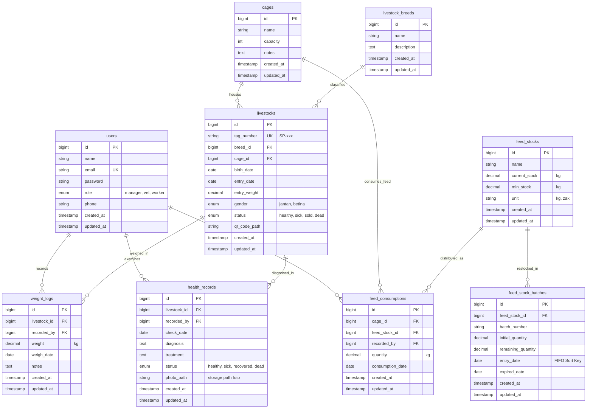

# 🗄️ Pedoman & Spesifikasi Entity Relationship Diagram (ERD) Si-Sapi
> **Dokumen Resmi Acuan Bab III Laporan Tugas Akhir / Ujikom**  
> **Proyek:** Si-Sapi (Smart Livestock Management System)  
> **Basis Data:** MySQL (InnoDb Engine)  
> **Notasi:** Crow's Foot Notation (Relasi 1:M dan Kardinalitas Tabel)

---

## 1. Ikhtisar Rancangan Basis Data

Sistem Si-Sapi menggunakan arsitektur basis data relasional terpusat pada MySQL. Seluruh data transaksi, identitas ternak, log timbangan, rekam medis foto darurat, serta pergerakan pakan disimpan dalam 9 entitas utama yang saling berelasi dengan integritas *Foreign Key*.

### Hubungan Operasional dengan Platform:
* **Operasi Melalui Desktop WPF (Manager & Vet):** Mengelola tabel master (`cages`, `livestock_breeds`, `livestocks`, `feed_stocks`, `feed_stock_batches`), meninjau rekam medis (`health_records`), serta mengagregasi data untuk laporan FCR (`feed_consumptions` dan `weight_logs`).
* **Operasi Melalui Mobile Android (Worker & Vet):** Menulis transaksi harian secara masif di lapangan: menambah data penimbangan (`weight_logs`), konsumsi pakan harian (`feed_consumptions`), serta mengunggah laporan darurat sapi sakit beserta berkas foto (`health_records`).

---

## 2. Diagram ERD (Crow's Foot Notation - Mermaid)



---

## 3. Kamus Data & Spesifikasi Tabel (Data Dictionary)

### 1. Tabel `users`
Menyimpan akun pengguna sistem dengan kontrol hak akses (Role-based Access Control).

| Nama Kolom | Tipe Data | Nullable | Keterangan |
|---|---|---|---|
| `id` | BIGINT UNSIGNED | No | Primary Key, Auto Increment |
| `name` | VARCHAR(255) | No | Nama lengkap pengguna |
| `email` | VARCHAR(255) | No | Email pengguna (Unique, untuk login) |
| `password` | VARCHAR(255) | No | Password terenkripsi (Bcrypt) |
| `role` | ENUM('manager','vet','worker') | No | Peran otorisasi sistem |
| `phone` | VARCHAR(20) | Yes | Nomor telepon / kontak darurat |
| `created_at` / `updated_at` | TIMESTAMP | Yes | Waktu pembuatan & pembaruan data |

---

### 2. Tabel `cages` (Kandang)
Menyimpan data identitas kandang peternakan.

| Nama Kolom | Tipe Data | Nullable | Keterangan |
|---|---|---|---|
| `id` | BIGINT UNSIGNED | No | Primary Key, Auto Increment |
| `name` | VARCHAR(255) | No | Nama atau kode kandang (contoh: "Kandang A1") |
| `capacity` | INT | No | Kapasitas daya tampung maksimal sapi |
| `notes` | TEXT | Yes | Catatan lokasi / spesifikasi kandang |
| `created_at` / `updated_at` | TIMESTAMP | Yes | Timestamp |

---

### 3. Tabel `livestock_breeds` (Ras Sapi)
Menyimpan referensi varietas atau ras sapi potong.

| Nama Kolom | Tipe Data | Nullable | Keterangan |
|---|---|---|---|
| `id` | BIGINT UNSIGNED | No | Primary Key, Auto Increment |
| `name` | VARCHAR(255) | No | Nama ras (Limousin, Simental, Brahman, Angus, dll.) |
| `description` | TEXT | Yes | Deskripsi karakteristik ras |
| `created_at` / `updated_at` | TIMESTAMP | Yes | Timestamp |

---

### 4. Tabel `livestocks` (Data Sapi)
Entitas sentral yang merepresentasikan setiap individu sapi potong.

| Nama Kolom | Tipe Data | Nullable | Keterangan |
|---|---|---|---|
| `id` | BIGINT UNSIGNED | No | Primary Key, Auto Increment |
| `tag_number` | VARCHAR(50) | No | Nomor identifikasi unik fisik (SP-001, SP-002, dst.) |
| `breed_id` | BIGINT UNSIGNED | No | Foreign Key merujuk ke `livestock_breeds.id` |
| `cage_id` | BIGINT UNSIGNED | No | Foreign Key merujuk ke `cages.id` |
| `birth_date` | DATE | Yes | Perkiraan tanggal lahir sapi |
| `entry_date` | DATE | No | Tanggal masuk sapi ke peternakan |
| `entry_weight` | DECIMAL(8,2) | No | Bobot awal sapi saat pertama masuk (kg) |
| `gender` | ENUM('jantan','betina') | No | Jenis kelamin |
| `status` | ENUM('healthy','sick','sold','dead') | No | Status kondisi sapi saat ini |
| `qr_code_path` | VARCHAR(255) | Yes | Path penyimpanan gambar QR Code ear tag |
| `created_at` / `updated_at` | TIMESTAMP | Yes | Timestamp |

---

### 5. Tabel `weight_logs` (Riwayat Penimbangan)
Mencatat hasil penimbangan berkala bobot sapi di lapangan.

| Nama Kolom | Tipe Data | Nullable | Keterangan |
|---|---|---|---|
| `id` | BIGINT UNSIGNED | No | Primary Key, Auto Increment |
| `livestock_id` | BIGINT UNSIGNED | No | Foreign Key merujuk ke `livestocks.id` |
| `recorded_by` | BIGINT UNSIGNED | No | Foreign Key merujuk ke `users.id` (Pekerja pencatat) |
| `weight` | DECIMAL(8,2) | No | Angka berat badan hasil timbangan (kg) |
| `weigh_date` | DATE | No | Tanggal pelaksanaan penimbangan |
| `notes` | TEXT | Yes | Catatan kondisi fisik ternak |
| `created_at` / `updated_at` | TIMESTAMP | Yes | Timestamp |

---

### 6. Tabel `health_records` (Rekam Medis & Laporan Darurat)
Menyimpan riwayat pemeriksaan kesehatan dan laporan darurat dengan foto.

| Nama Kolom | Tipe Data | Nullable | Keterangan |
|---|---|---|---|
| `id` | BIGINT UNSIGNED | No | Primary Key, Auto Increment |
| `livestock_id` | BIGINT UNSIGNED | No | Foreign Key merujuk ke `livestocks.id` |
| `recorded_by` | BIGINT UNSIGNED | No | Foreign Key merujuk ke `users.id` (Dokter/Pekerja) |
| `check_date` | DATE | No | Tanggal pemeriksaan / waktu pelaporan |
| `diagnosis` | TEXT | No | Diagnosis penyakit atau deskripsi gejala darurat |
| `treatment` | TEXT | Yes | Tindakan medis, resep obat, atau vaksin yang diberikan |
| `status` | ENUM('healthy','sick','recovered','dead') | No | Status kesehatan sapi pasca tindakan |
| `photo_path` | VARCHAR(255) | Yes | Lokasi file foto kondisi sapi (storage/health-reports/...) |
| `created_at` / `updated_at` | TIMESTAMP | Yes | Timestamp |

---

### 7. Tabel `feed_stocks` (Master Pakan)
Menyimpan data katalog jenis pakan ternak.

| Nama Kolom | Tipe Data | Nullable | Keterangan |
|---|---|---|---|
| `id` | BIGINT UNSIGNED | No | Primary Key, Auto Increment |
| `name` | VARCHAR(255) | No | Nama jenis pakan (Konsentrat A, Rumput Gajah, dll.) |
| `current_stock` | DECIMAL(10,2) | No | Total stok terkini yang tersedia di gudang |
| `min_stock` | DECIMAL(10,2) | No | Batas minimal stok sebelum peringatan menipis |
| `unit` | VARCHAR(20) | No | Satuan pengukuran (kg, zak, ton) |
| `created_at` / `updated_at` | TIMESTAMP | Yes | Timestamp |

---

### 8. Tabel `feed_stock_batches` (Batch Stok Masuk - Algoritma FIFO)
Menyimpan setiap transaksi kedatangan pasokan pakan untuk pemotongan urut waktu.

| Nama Kolom | Tipe Data | Nullable | Keterangan |
|---|---|---|---|
| `id` | BIGINT UNSIGNED | No | Primary Key, Auto Increment |
| `feed_stock_id` | BIGINT UNSIGNED | No | Foreign Key merujuk ke `feed_stocks.id` |
| `batch_number` | VARCHAR(50) | No | Kode unik batch (misal: "BATCH-202610-01") |
| `initial_quantity` | DECIMAL(10,2) | No | Jumlah kuantitas pakan saat batch tiba (kg) |
| `remaining_quantity` | DECIMAL(10,2) | No | Sisa stok pakan pada batch ini (kg) |
| `entry_date` | DATE | No | Tanggal masuk (Kunci urutan sortir pemotongan FIFO) |
| `expired_date` | DATE | Yes | Tanggal kedaluwarsa pakan |
| `created_at` / `updated_at` | TIMESTAMP | Yes | Timestamp |

---

### 9. Tabel `feed_consumptions` (Konsumsi Pakan Kandang)
Mencatat porsi pakan harian yang diberikan pada suatu kandang (dasar kalkulasi FCR).

| Nama Kolom | Tipe Data | Nullable | Keterangan |
|---|---|---|---|
| `id` | BIGINT UNSIGNED | No | Primary Key, Auto Increment |
| `cage_id` | BIGINT UNSIGNED | No | Foreign Key merujuk ke `cages.id` |
| `feed_stock_id` | BIGINT UNSIGNED | No | Foreign Key merujuk ke `feed_stocks.id` |
| `recorded_by` | BIGINT UNSIGNED | No | Foreign Key merujuk ke `users.id` (Pekerja pemberi pakan) |
| `quantity` | DECIMAL(10,2) | No | Jumlah pakan yang dikonsumsi (kg) |
| `consumption_date` | DATE | No | Tanggal pemberian pakan |
| `created_at` / `updated_at` | TIMESTAMP | Yes | Timestamp |

---

## 4. Panduan Prompt untuk AI Pembuat Diagram (PlantUML / Draw.io / Eraser.io)

### Prompt ERD PlantUML:
```text
Buatkan Entity Relationship Diagram (ERD) profesional menggunakan notasi Crow's Foot pada PlantUML untuk database MySQL sistem "Si-Sapi".

Entitas dan Atribut:
1. users (id PK, name, email, password, role [manager, vet, worker], phone)
2. cages (id PK, name, capacity, notes)
3. livestock_breeds (id PK, name, description)
4. livestocks (id PK, tag_number, breed_id FK, cage_id FK, birth_date, entry_date, entry_weight, gender, status, qr_code_path)
5. weight_logs (id PK, livestock_id FK, recorded_by FK, weight, weigh_date, notes)
6. health_records (id PK, livestock_id FK, recorded_by FK, check_date, diagnosis, treatment, status, photo_path)
7. feed_stocks (id PK, name, current_stock, min_stock, unit)
8. feed_stock_batches (id PK, feed_stock_id FK, batch_number, initial_quantity, remaining_quantity, entry_date, expired_date)
9. feed_consumptions (id PK, cage_id FK, feed_stock_id FK, recorded_by FK, quantity, consumption_date)

Relasi:
- users ||--o{ weight_logs
- users ||--o{ health_records
- users ||--o{ feed_consumptions
- cages ||--o{ livestocks
- cages ||--o{ feed_consumptions
- livestock_breeds ||--o{ livestocks
- livestocks ||--o{ weight_logs
- livestocks ||--o{ health_records
- feed_stocks ||--o{ feed_stock_batches
- feed_stocks ||--o{ feed_consumptions

Gunakan skinparam entityBackgroundColor #F9F9FB, border color #4A5568, font Times New Roman, dan tata letak simetris yang mudah dibaca.
```
