# ⏱️ Pedoman & Spesifikasi Sequence Diagram Si-Sapi
> **Dokumen Resmi Acuan Bab III Laporan Tugas Akhir / Ujikom**  
> **Proyek:** Si-Sapi (Smart Livestock Management System)  
> **Arsitektur:** Multi-tier Client-Server (Aktor $\rightarrow$ UI Layer $\rightarrow$ ViewModel/API Client $\rightarrow$ REST Controller $\rightarrow$ Service Layer $\rightarrow$ Eloquent Model $\rightarrow$ MySQL Database).

---

## 1. Ikhtisar Sequence Diagram

Sequence Diagram menggambarkan interaksi antar-objek dan komponen secara berurutan berdasarkan dimensi waktu (*chronological messages*). Pada Si-Sapi, terdapat pembagian alur yang tegas antara:
- **Client Desktop (C# WPF):** Berfokus pada interaksi antarmuka XAML, View-Logic code-behind, deserialisasi JSON (`Newtonsoft.Json`), dan manipulasi data analitik/laporan.
- **Client Mobile (Kotlin Android):** Berfokus pada arsitektur MVVM, pemanggilan asynchronous coroutine/Retrofit2, penanganan kamera perangkat, dan transmisi payload multipart.
- **Backend API (Laravel 11):** Menggunakan pola *Service Layer Pattern* di mana Controller hanya bertindak sebagai pintu gerbang HTTP, sedangkan kalkulasi bisnis kompleks (FCR, FIFO, auto-numbering) dipusatkan di `app/Services/`.

---

## 2. Sequence Diagram: Platform Desktop (WPF)

### A. SD-D01: Login & Autentikasi Pengguna Desktop
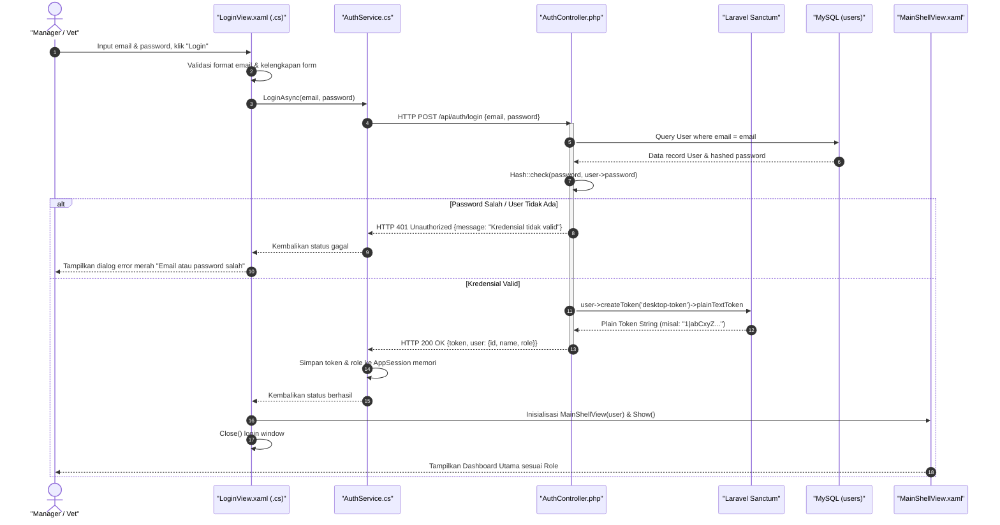

---

### B. SD-D02: Input Sapi Baru & Auto-Generate Tag `SP-xxx`
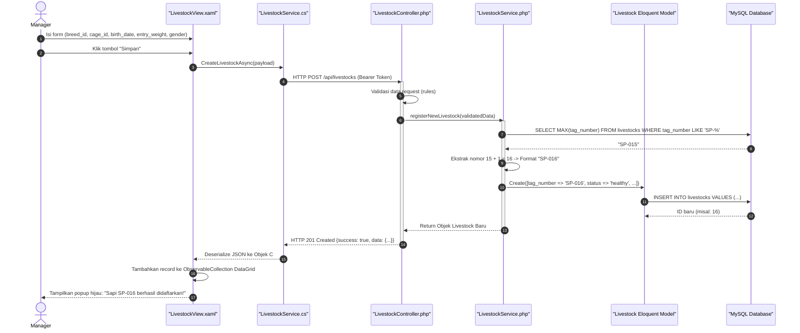

---

### C. SD-D03: Evaluasi & Perhitungan Laporan FCR Kandang
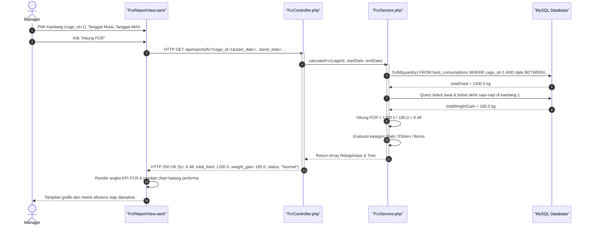

---

### D. SD-D04: Menampilkan Pop-up Foto Bukti Kondisi Darurat Sapi Sakit
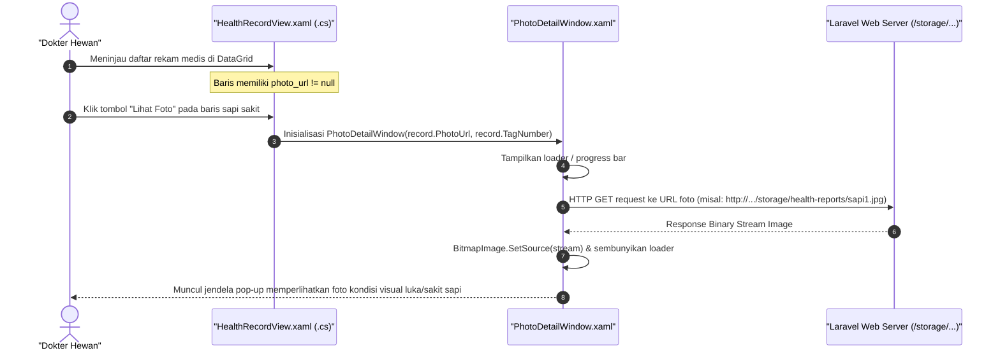

---

### E. SD-D05: Pengelolaan Data Master Kandang (CRUD)
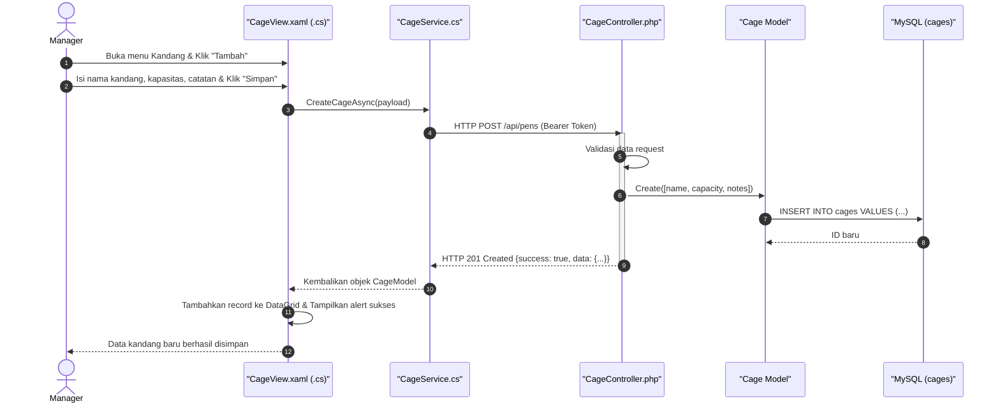

---

### F. SD-D06: Pengelolaan Master Pakan & Penambahan Batch Baru (Restock)
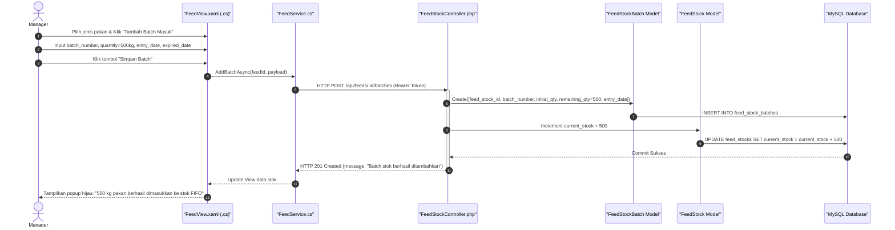

---

### G. SD-D07: Update Data Sapi & Normalisasi (Method PUT/PATCH)
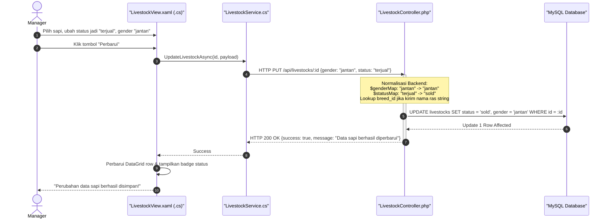

---

### H. SD-D08: Pencetakan Label QR Code Ear Tag
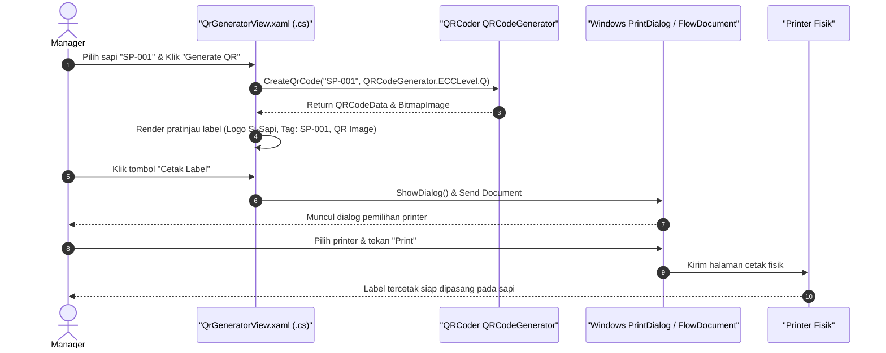

---

## 3. Sequence Diagram: Platform Mobile (Android)


### A. SD-M01: Scan QR Code Ear Tag & Buka Profil Sapi
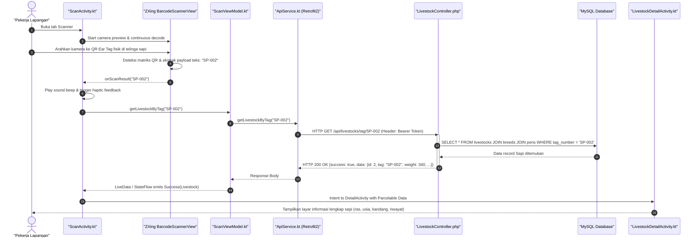

---

### B. SD-M02: Pencatatan Penimbangan Cepat (Quick Weight Logging)
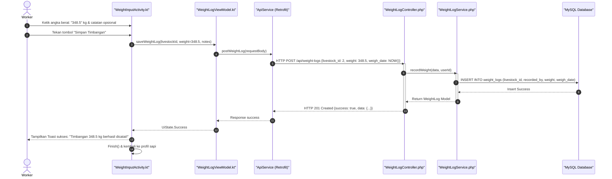

---

### C. SD-M03: Pencatatan Konsumsi Pakan Berbasis FIFO (Auto Deduction)
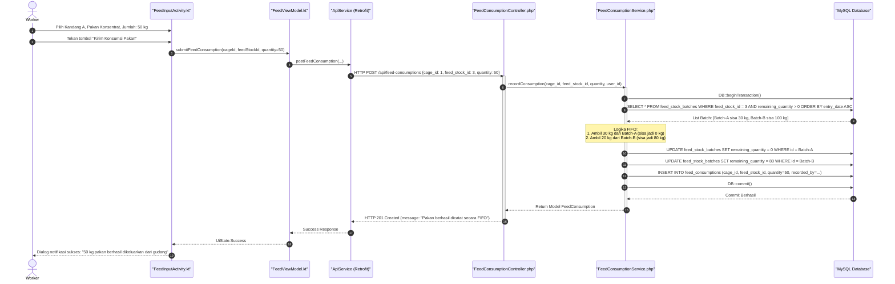

---

### D. SD-M04: Pelaporan Darurat Sapi Sakit dengan Unggah Foto Kamera
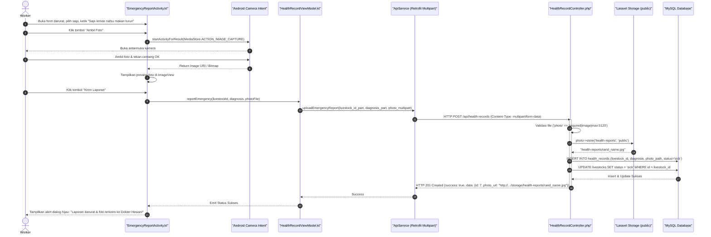

---

### E. SD-M05: Login & Autentikasi Pengguna Mobile
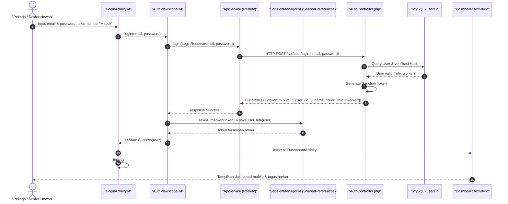

---

### F. SD-M06: Input Tindakan Medis Lapangan oleh Dokter Hewan (TreatmentActivity)
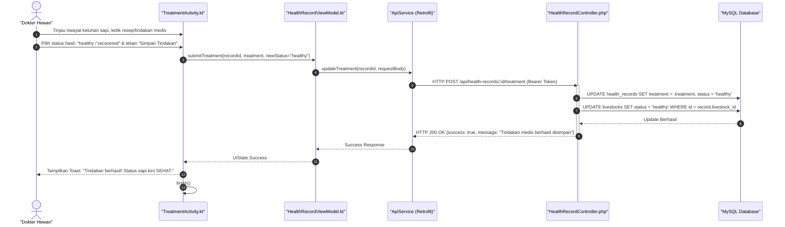

---

### G. SD-M07: Pengambilan Pengingat / Reminder Jadwal Vaksinasi
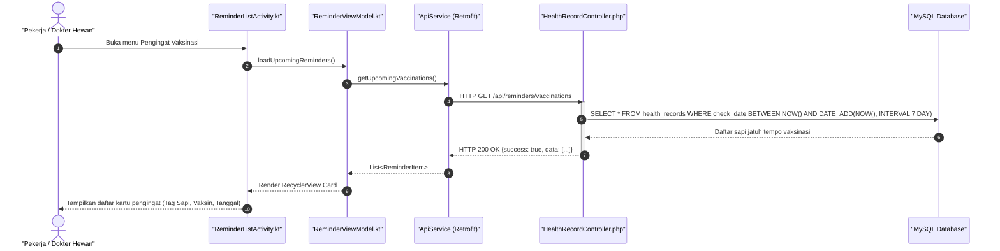

---

## 4. Panduan Prompt untuk AI Pembuat Diagram (PlantUML / Draw.io)


### Prompt Sequence Diagram PlantUML:
```text
Buatkan Sequence Diagram PlantUML modern yang elegan untuk alur:
"Pencatatan Konsumsi Pakan Harian berbasis Algoritma FIFO pada Sistem Si-Sapi".

Partisipan yang terlibat:
- actor "Pekerja Kandang" as Worker
- boundary "FeedInputActivity" as UI
- control "FeedViewModel" as VM
- control "ApiService (Retrofit)" as Retrofit
- boundary "FeedConsumptionController" as Controller
- control "FeedConsumptionService" as Service
- database "MySQL Database" as DB

Skenario:
1. Worker menginput konsumsi 50 kg untuk pakan konsentrat di kandang A.
2. Request dikirim hingga ke Service Layer.
3. Service memulai transaksi DB (DB::beginTransaction).
4. Service mencari batch pakan dengan tanggal masuk tertua (ORDER BY entry_date ASC).
5. Service memotong stok batch tertua lebih dulu hingga total 50 kg tercukupi.
6. Service menyimpan record konsumsi pakan dan melakukan commit transaksi.
7. Mengembalikan response HTTP 201 Created hingga worker melihat dialog sukses.
Gunakan styling PlantUML modern dengan warna background putih, lifeline jelas, dan autonumber.
```
