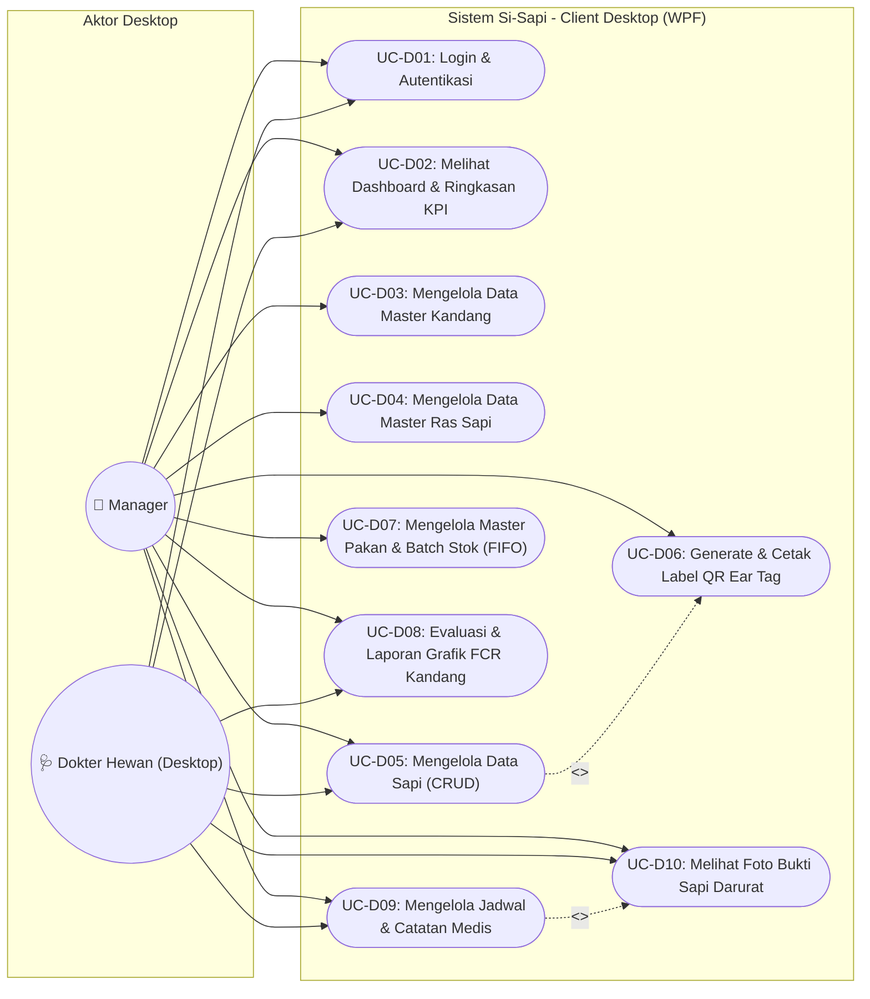
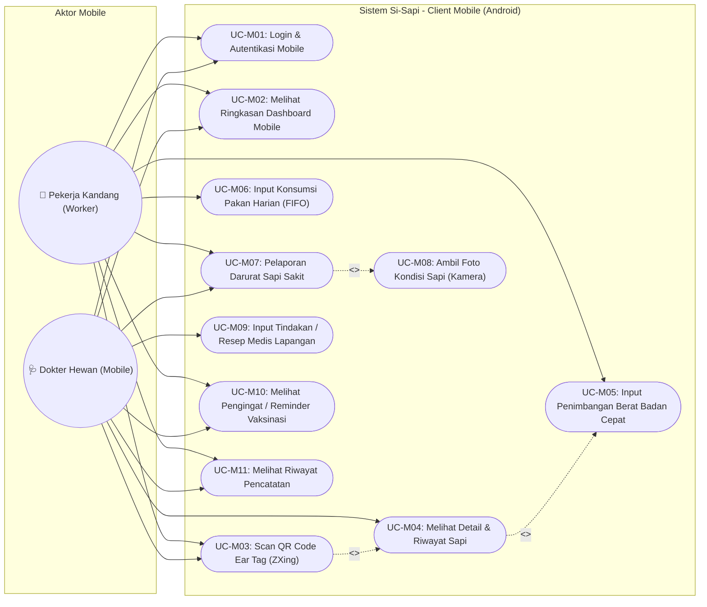

# 📋 Pedoman & Spesifikasi Use Case Diagram Si-Sapi
> **Dokumen Resmi Acuan Bab III Laporan Tugas Akhir / Ujikom**  
> **Proyek:** Si-Sapi (Smart Livestock Management System)  
> **Arsitektur:** Client-Server (1 Backend REST API melayani 2 Platform: Desktop WPF & Mobile Android)

---

## 1. Konteks Arsitektur & Aktor Sistem

Sistem Si-Sapi dirancang dengan pemisahan tugas (*separation of concerns*) yang jelas antara platform **Desktop (WPF)** dan **Mobile (Android)**.

### Definisi Aktor:
1. **Manager (Pemilik/Pengelola Peternakan):**
   * **Platform Akses:** Desktop WPF.
   * **Tanggung Jawab:** Manajemen master data (sapi, kandang, pakan), pencetakan label QR code fisik (Ear Tag), monitoring dashboard performa peternakan, pemantauan stok pakan, dan analisis efisiensi pakan (Feed Conversion Ratio / FCR).
2. **Dokter Hewan / Vet (Tenaga Medis Hewan):**
   * **Platform Akses:** Desktop WPF & Mobile Android.
   * **Tanggung Jawab Desktop:** Manajemen jadwal vaksinasi, evaluasi rekam medis historis, dan peninjauan foto laporan kondisi darurat sapi sakit.
   * **Tanggung Jawab Mobile:** Pemeriksaan langsung di kandang, pencatatan rekam medis/tindakan medis di lapangan, dan pemantauan daftar pengingat (*reminder*) vaksinasi.
3. **Pekerja Kandang / Worker (Petugas Lapangan):**
   * **Platform Akses:** Mobile Android Native.
   * **Tanggung Jawab:** Operasional harian di lapangan: pemindaian QR code ear tag sapi untuk identifikasi cepat, pencatatan timbangan berat badan rutin, pencatatan porsi konsumsi pakan harian kandang, serta pelaporan darurat jika menemukan sapi sakit lengkap dengan foto kamera.

---

## 2. Diagram Use Case: Platform Desktop (WPF)

### Diagram Mermaid (Desktop WPF)


---

## 3. Diagram Use Case: Platform Mobile (Android)

### Diagram Mermaid (Mobile Android)


---

## 4. Tabel Rincian Deskripsi Use Case

### A. Use Case Desktop (WPF)

| Kode UC | Nama Use Case | Aktor | Deskripsi Singkat |
|---|---|---|---|
| **UC-D01** | Login & Autentikasi | Manager, Vet | Pengguna memasukkan kredensial email & password untuk memperoleh token otentikasi Sanctum serta hak akses menu Desktop. |
| **UC-D02** | Melihat Dashboard & Ringkasan KPI | Manager, Vet | Menampilkan statistik total populasi sapi, jumlah kandang terisi, peringatan stok pakan menipis, dan ringkasan FCR global. |
| **UC-D03** | Mengelola Data Master Kandang | Manager | Melakukan tambah, ubah, dan hapus data kandang (nama, kapasitas maksimal). |
| **UC-D04** | Mengelola Data Master Ras Sapi | Manager | Mengelola data referensi ras sapi (Limousin, Simental, Brahman, Angus, dll.). |
| **UC-D05** | Mengelola Data Sapi (CRUD) | Manager, Vet (View) | Mendaftarkan sapi baru (auto-generate nomor tag `SP-xxx`), mengubah status sapi (sehat, sakit, terjual, mati), memindahkan kandang, dan filter data. |
| **UC-D06** | Generate & Cetak Label QR Ear Tag | Manager | Mengenerate gambar QR code berdasarkan `tag_number` sapi menggunakan library QRCoder, kemudian mencetak label fisik untuk dipasang di telinga sapi. |
| **UC-D07** | Mengelola Master Pakan & Batch Stok (FIFO) | Manager | Menambah jenis pakan, mencatat penerimaan batch stok pakan baru dengan tanggal kedatangan (`entry_date`), serta memantau sisa stok per batch. |
| **UC-D08** | Evaluasi & Laporan Grafik FCR Kandang | Manager, Vet | Memilih kandang dan rentang periode waktu untuk melihat nilai FCR hasil kalkulasi otomatis backend disertai grafik kenaikan bobot vs konsumsi pakan. |
| **UC-D09** | Mengelola Jadwal & Catatan Medis | Vet, Manager (View) | Mencatat riwayat pemeriksaan kesehatan, tindakan medis/pengobatan yang diberikan, serta mengatur jadwal vaksinasi berkala. |
| **UC-D10** | Melihat Foto Bukti Sapi Darurat | Manager, Vet | Menampilkan jendela pop-up foto bukti fisik sapi yang dilaporkan sakit/darurat oleh pekerja dari aplikasi mobile. |

### B. Use Case Mobile (Android)

| Kode UC | Nama Use Case | Aktor | Deskripsi Singkat |
|---|---|---|---|
| **UC-M01** | Login & Autentikasi Mobile | Worker, Vet | Autentikasi pengguna lapangan berbasis token, membatasi akses antarmuka sesuai role Worker atau Vet. |
| **UC-M02** | Melihat Ringkasan Dashboard Mobile | Worker, Vet | Menampilkan ringkasan tugas harian, jumlah sapi di kandang yang ditugaskan, dan status pakan. |
| **UC-M03** | Scan QR Code Ear Tag | Worker, Vet | Memindai QR code fisik di telinga sapi menggunakan kamera perangkat (ZXing Library) untuk membuka profil sapi secara instan tanpa mengetik tag manual. |
| **UC-M04** | Melihat Detail & Riwayat Sapi | Worker, Vet | Menampilkan rincian identitas sapi, ras, bobot terakhir, kandang saat ini, dan riwayat kesehatan. |
| **UC-M05** | Input Penimbangan Cepat | Worker | Menginput angka hasil timbangan berkala sapi secara langsung di kandang setelah memindai QR code. |
| **UC-M06** | Input Konsumsi Pakan Harian | Worker | Mencatat jumlah pakan (kg) yang diberikan ke kandang tertentu pada hari tersebut; backend otomatis memotong stok batch secara FIFO. |
| **UC-M07** | Pelaporan Darurat Sapi Sakit | Worker, Vet | Melaporkan kondisi sapi yang mengalami gejala sakit atau cedera mendadak di kandang. |
| **UC-M08** | Ambil Foto Kondisi Sapi | Worker, Vet | Mengambil foto kondisi fisik sapi langsung dari kamera Android untuk diunggah sebagai lampiran `multipart/form-data` pada laporan darurat. |
| **UC-M09** | Input Tindakan Medis Lapangan | Vet | Dokter hewan menginput resep, obat, atau tindakan kuratif langsung di lokasi kandang setelah melakukan pemeriksaan. |
| **UC-M10** | Melihat Pengingat Vaksinasi | Worker, Vet | Menampilkan daftar sapi yang memiliki jadwal vaksinasi/vitamin mendekati jatuh tempo. |
| **UC-M11** | Melihat Riwayat Pencatatan | Worker, Vet | Menampilkan riwayat input penimbangan dan pakan yang telah berhasil disinkronkan ke server. |

---

## 5. Panduan Prompt untuk AI Pembuat Diagram (PlantUML / Draw.io)

Jika Anda ingin menghasilkan diagram grafis menggunakan AI lain (misalnya ChatGPT Plus, Claude, Eraser.io, atau PlantUML online), gunakan instruksi baku berikut:

### Prompt Siap Pakai untuk Desktop:
```text
Buatkan diagram Use Case UML standar menggunakan PlantUML untuk aplikasi Desktop "Si-Sapi (Sistem Informasi Peternakan Sapi Potong)".
Aktor:
- "Manager" (akses penuh administrasi dan analitik)
- "Dokter Hewan" (akses rekam medis dan pemantauan kesehatan)

Use Case yang harus ada:
1. Login & Autentikasi
2. Melihat Dashboard & KPI
3. Kelola Master Kandang (CRUD)
4. Kelola Master Pakan & Batch FIFO (CRUD)
5. Kelola Master Sapi & Auto-generate Tag SP-xxx
6. Cetak Label QR Code Ear Tag (include dari Kelola Sapi)
7. Melihat Laporan & Grafik FCR
8. Kelola Rekam Medis & Vaksinasi
9. Melihat Foto Bukti Sapi Sakit (extend dari Rekam Medis)

Pisahkan dalam package "Desktop WPF Application" dengan styling modern, rapi, dan panah relasi yang jelas.
```

### Prompt Siap Pakai untuk Mobile:
```text
Buatkan diagram Use Case UML standar menggunakan PlantUML untuk aplikasi Android Mobile "Si-Sapi".
Aktor:
- "Pekerja Kandang (Worker)" (operasional kandang)
- "Dokter Hewan (Vet)" (tindakan medis lapangan)

Use Case yang harus ada:
1. Login Mobile
2. Melihat Dashboard Operasional
3. Scan QR Code Ear Tag Sapi (ZXing)
4. Melihat Detail Data Sapi (include dari Scan QR)
5. Input Penimbangan Berat Badan
6. Input Konsumsi Pakan Harian (FIFO)
7. Lapor Kondisi Darurat Sapi Sakit
8. Ambil Foto Bukti dengan Kamera (include dari Lapor Darurat)
9. Input Tindakan Medis Lapangan (khusus Dokter Hewan)
10. Cek Reminder Jadwal Vaksinasi
11. Riwayat Aktivitas Input

Beri batasan sistem dalam kotak "Android Mobile Application".
```
